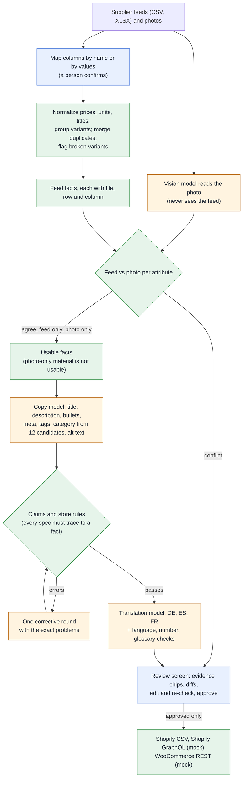
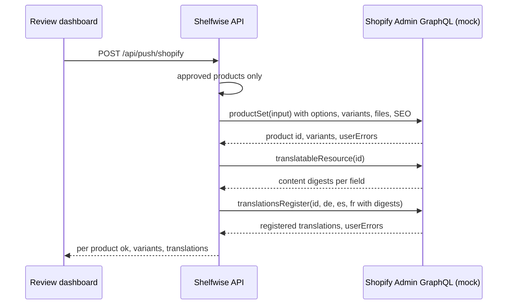
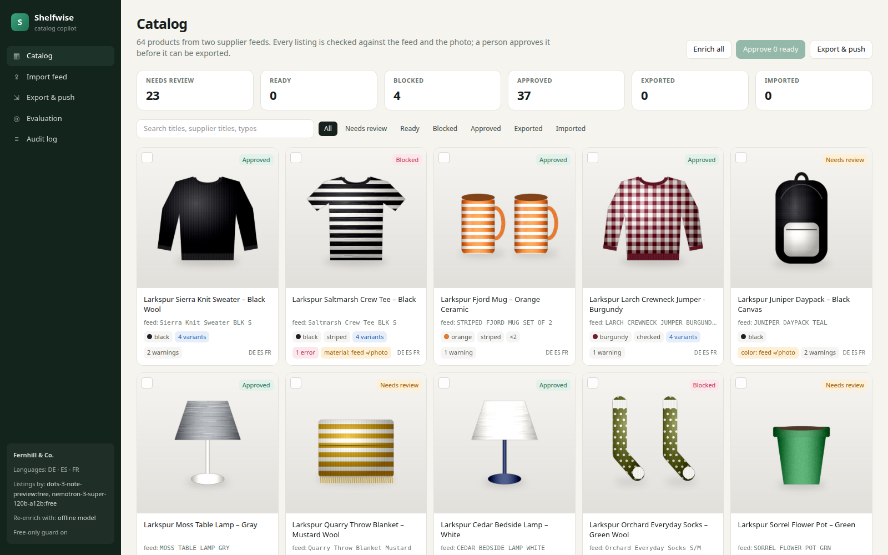
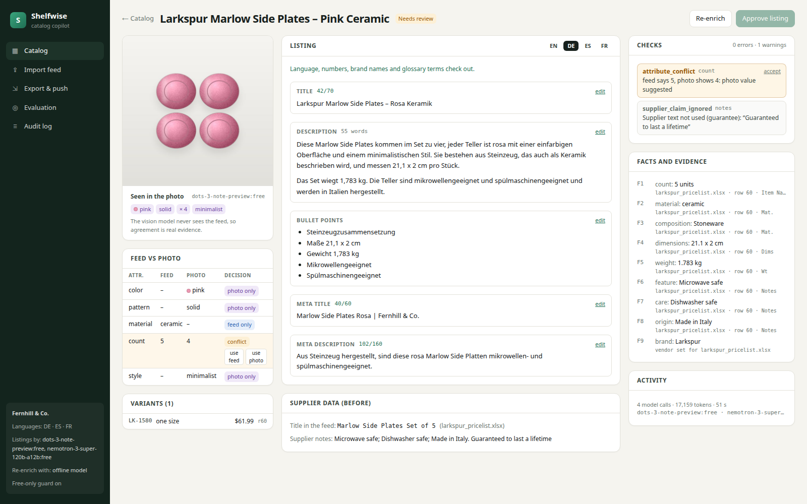
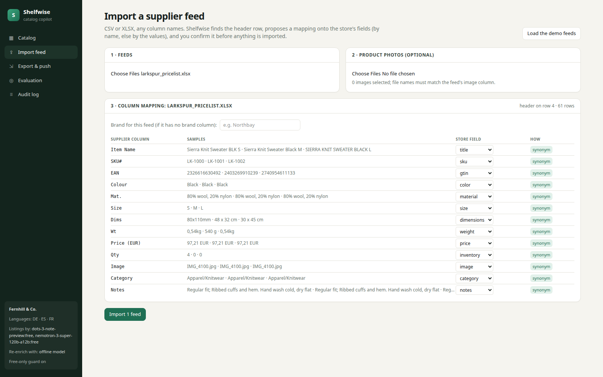
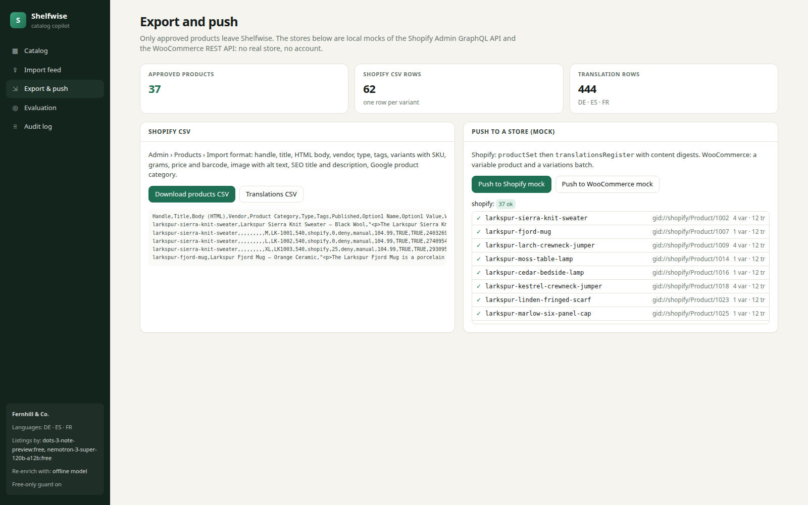
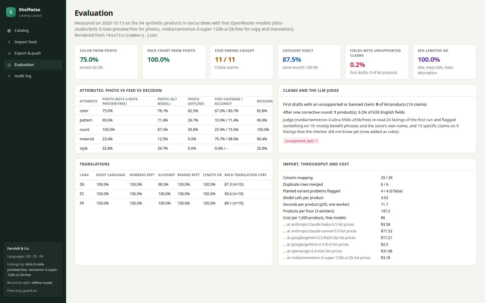

# Shelfwise: an AI catalog copilot for Shopify and WooCommerce

**Drop in a messy supplier feed and the product photos. Shelfwise maps the columns, normalizes units and prices, groups variants and merges duplicates. A vision model reads each photo without seeing the feed and its answer is checked against the feed. Then a language model writes the SEO title, description, bullets, meta tags, category, alt text and DE/ES/FR translations in your brand voice, from the facts only. Code checks every claim against the feed and the photo, a person approves each listing in a review screen with diffs and per-field evidence, and only approved products go out as a Shopify CSV or through the (mock) Shopify and WooCommerce APIs.**

[](https://github.com/gelevanog/ecommerce-catalog-copilot/actions/workflows/ci.yml)


-7AB55C?logo=shopify&logoColor=white)
-96588A?logo=woocommerce&logoColor=white)


<!-- demo-video -->

![The review screen of one product: the photo with the attributes the vision model saw (pink, solid, 4 items), a feed-vs-photo table where the pack size is a conflict (feed says 5, photo shows 4) with "use feed" and "use photo" buttons, the generated listing with character counters and evidence chips under every field, a hovered chip showing the feed cell (larkspur_pricelist.xlsx, row 60, "Marlow Side Plates Set of 5") and the image evidence ("4, confidence 1.00"), and on the right the checks (the conflict and an ignored supplier claim "Guaranteed to last a lifetime") and the facts with the spreadsheet cell each came from](docs/screenshots/hero.png)

<sub>A product from the evaluation run with free models (`dots-studio/dots-3-note-preview:free` for the photo, `nvidia/nemotron-3-super-120b-a12b:free` for copy and translations). The supplier's spreadsheet sells "Marlow Side Plates Set of 5"; the photo shows four. Shelfwise suggests the photo's value, stops the listing from being approved until a person decides, and shows where every stated fact came from (hovered: the pack size, from row 60 of the spreadsheet and from the photo). The supplier's "Guaranteed to last a lifetime" never reached the copy.</sub>

**Measured on 2026-10-13** on 64 fictional products from two fictional suppliers (an XLSX price list and a semicolon CSV, 107 rows with sizes, duplicates and planted errors) with product renders whose true attributes are known, using free OpenRouter models only:

| | Result |
|---|---|
| Import of two messy feeds | **29 of 29** columns mapped, **64 of 64** products with their variants grouped, **6 of 6** duplicate rows merged (3 across suppliers), **4 of 4** broken variants flagged (a 10x price, a different material in one size), 0 false flags; units right for 45/45 dimensions, 64/64 weights, 9/9 capacities, 63/64 prices (the 64th is the planted 10x outlier) |
| Attributes from the photo (vision model never sees the feed) | pack size **100%** (64/64), pattern **90.6%**, main color **75.0%** exact and **92.2%** within the color family, material 23.4%, style 32.8% |
| Supplier errors caught by feed-vs-photo | **11 of 11** planted wrong colors and pack sizes raised as conflicts, **0** false alarms on 48 correct feed values (as first run: 9 of 11 and 2 false alarms; two bugs fixed, see Findings) |
| Unsupported claims (every stated spec, material, color, pattern, pack size and claim phrase checked against the evidence) | first drafts: **9** of 64 listings with an unsupported claim (14 claims, mostly a pack's weight stated per item, then "resists stains", "relaxed fit", a zip the feed never mentions); after one corrective round **1** listing (1 of 626 English fields), which cannot be approved until a person fixes it; **0** listings that state a wrong color, pack size or material when checked against the true labels; 0 of 22 supplier claims ("relieves back pain", "FDA approved", "eco-friendly") used |
| LLM judge spot check (a different free model re-read 20 listings of the first run) | it found **15 specific claims with no fact behind them on 9 of 20 listings** that my first checker passed ("resists stains", "relaxed fit", "breathable", a zip, a pack's weight given per item), plus 5 pieces of care advice the feed does not give and 38 benefit phrases ("ideal for picnics"); the checker now catches the first kind, the rest stay with the reviewer |
| Category and type | Google product category exact **87.5%** (56/64), right branch **100%**; Shopify product type **100%** |
| SEO lengths | title, meta title and meta description inside the limits on **100%** of the 64 listings |
| Translations DE / ES / FR (192 listings) | right language, every number and brand name kept: **100%**; glossary terms 98.3% / 100% / 100%; fields left in English 0.9% / 0.5% / 0.4%; back-translation chrF 87.3 / 90.6 / 89.1 (10 listings each, every number kept) |
| Throughput and cost | **3.0 model calls** per product, 72 s per product (median) and **147 products per hour** with 3 workers on the free tier; **$0** with free models; about **$3.2 to $72 per 1,000 products** at paid list prices of the same open model up to Claude Sonnet 5.5 (token counts of a reasoning model, see below) |
| Cloud usage | **546** requests to OpenRouter (374 answered, 160 retried after rate limits and overloaded upstreams), every requested and served model id `:free` ([ledger](results/calls.jsonl)) |

**The honest verdict:** the parts that decide whether a catalog is trustworthy work well with free models, because code does the checking. The vision model counted items in a pack perfectly and read patterns and colors well enough that every planted supplier error (a wrong color, a wrong pack size) surfaced as a conflict for a person; the copy model stayed inside the facts on 55 of 64 first drafts, the corrective round fixed 8 of the other 9, and the last one is held for a person; translations kept every number and brand name. The weak spot is plausible filler: an independent judge model found claims like "breathable" or "resists stains" that my first checker did not know, so I added them; the copy still contains benefit phrases ("ideal for picnics") that no code checks. What free vision models cannot do is tell materials apart from a photo (23%), so Shelfwise never states a material that only the photo suggests, and "style" is too subjective to be a spec (33% agreement with my labels). The run also found real bugs in my own checker, which are reported below: it read "Flower Pot" as a floral pattern and made the model rename two products, it treated pink and burgundy as the same color, and it took "Moss" in a product name for a color. All three are fixed and the numbers above are from the re-run; the as-run numbers are in Findings. The products and photos are synthetic renders I generated with known labels, cleaner than a real catalog: read the numbers as evidence that the mechanisms work, not as a forecast for your store.

## What problem it solves

Store owners and agencies get product data from suppliers as spreadsheets nobody designed: a title row above the header, "Mat." and "Wt" and "rrp_usd" as column names, prices as "€24,90", sizes as separate rows, the same product twice, and notes like "Best seller!! Relieves back pain". Turning that into a catalog means mapping columns, cleaning units, writing hundreds of titles, descriptions, bullet points, meta tags and alt texts, choosing categories, translating everything, and then checking it all, because one invented "dishwasher safe" or "100% organic" is a returns problem, and in the EU a "sustainable" without a certificate is now a legal one.

"Just ask ChatGPT" gets the writing done and moves the risk: a model happily repeats a supplier's medical claim, fills a missing material with a guess, writes "set of 5" when the photo shows four, and nobody can tell which sentence came from where. Shelfwise keeps the model for what it is good at (reading a photo, writing in a voice, translating) and puts code around it for everything else: deterministic import and normalization, an independent look at the photo, a claims checker that ties every statement to a cell of the feed or to the photo, store rules for lengths and wording, a person approving each listing with the evidence in front of them, and an export that refuses anything not approved.

## Features

- **Import any supplier feed.** CSV (delimiter sniffed) or XLSX (header row found below title rows). Columns are mapped onto the store's fields by name (a synonym table: "Mat.", "material_composition", "colour_name", "rrp_usd", "SKU#") or, failing that, by their values (13-digit numbers are GTINs, "30 x 20 cm" is a dimension, "€12,50" is a price); the import screen shows the proposal with sample values and a person can change any mapping. Prices in any format ("€24,90", "1.299,00 €", "24,90 EUR") are converted to the store currency with a fixed table; dimensions in cm, mm or inches, weights in g, kg or lb and capacities in ml, l or fl oz become cm, g and ml. Size rows are grouped into one product with variants by their base title (size, color abbreviations like "NVY", pack and pattern words removed); duplicate rows (same GTIN or SKU, also across suppliers) are merged and recorded with the price difference; variants that disagree on material or have a price 3x off the others are errors that block the product.
- **Feed facts with their cell.** Every fact (color, material, composition, dimensions, weight, capacity, care, features, origin, pack size, brand) keeps the file, row and column it came from and the raw text. Supplier notes are split into statements; the ones that trip the banned-claims rules ("Best seller", "Relieves back pain", "FDA approved", "Eco-friendly and sustainable") are not facts and are shown to the reviewer as ignored.
- **The photo, seen blind.** A vision model reports color, second color, pattern, visible material, style and the number of items, without ever seeing the feed, so agreement is evidence. Its words are mapped onto controlled vocabularies (18 colors, 6 patterns, 14 materials, 6 styles, with the synonyms suppliers and models use: "charcoal", "Breton stripe", "stoneware").
- **Feed vs photo, one decision per attribute.** Agree, conflict, feed only, photo only or missing, with both values and both pieces of evidence. Color, pattern and pack size are visual: on a conflict the photo's value is suggested (when the model was confident) and the product waits for a person. Material is a spec: the feed wins, and a material seen only in the photo is a suggestion for the reviewer, never written into the listing. Close shades (navy and blue, olive and green) agree; distant ones (pink and burgundy) are a conflict.
- **Copy in your voice, from facts only.** The model gets a numbered facts list (each with its source), the style guide (voice, title pattern, rules, two examples, words to avoid), the store's limits and product types, and 12 Google product categories retrieved by code; it returns the title, an HTML description, bullets, meta title and description, tags, product type, category id and one alt text per image. If validation fails, it gets one corrective round with the exact problems ("“dishwasher safe” is not backed by the feed", "meta description 172 characters, the limit is 160").
- **No invented specs.** The claims checker reads every field like an editor: numbers with units (in any unit, converted, with a tolerance), dimension expressions ("8 x 11 cm"), pack sizes ("set of 4", "3-pack", "two pairs"), materials, colors, patterns and claim phrases that need a fact ("dishwasher safe", "organic", "recycled", "BPA-free", "leak-proof", "made in Portugal", "handmade"...). Each must trace to a feed fact or a usable photo attribute; product names and brand names are not claims ("Moss Tote" is not olive). Banned claims are errors whatever the evidence: superlatives, guarantees, medical and health claims, FDA, and generic green claims (EU Directive 2024/825). The same pass records which facts each field states: the evidence chips under every field in the review screen.
- **Store rules.** Title 20-70 characters starting with the brand, meta title 25-60, meta description 70-160, 3-5 bullets of at most 160 characters, description 40-180 words in allowed HTML only (no scripts or event handlers), alt text under 125 characters and not "image of...", 3-10 tags, product type from the store's list, a valid Google category id, no sizes in titles, no exclamation marks. Across the catalog: duplicate titles and handles, and descriptions so alike (4-word shingles, Jaccard 0.6) that search engines treat them as duplicates.
- **Translations with checks that need no second model.** One call for DE, ES and FR (one per language when that fails), the glossary in the prompt, and checks in code: the right language (stopword profile), every number kept, brand names untouched, glossary terms used (German compounds allowed), HTML structure kept, fields left in English flagged, length limits with 15% slack; over the limit, the model gets one round to shorten. A back-translation spot check is part of the evaluation.
- **Human review.** A catalog grid with status filters, search, selection and bulk actions; a review screen per product with the photo and what the vision model saw, the feed-vs-photo table with "use feed / use photo", the listing per language with character counters, issues per field, evidence chips with the source cell on hover, inline editing that re-validates on save, a word diff of the edit against the generated text, revert, and the supplier's original data. Approval is refused while there are open errors or feed/photo conflicts; a reviewer can accept a warning or a variant problem with a reason, never an unsupported claim. "Approve ready" approves only listings with no errors and no conflicts. Every action goes to an audit log with who did it.
- **Export and push only what was approved.** A Shopify product CSV (Admin › Products › Import columns: handle, title, body, vendor, type, tags, one row per variant with SKU, grams, price, barcode, image with alt text, SEO title and description, Google category) and a translations CSV in Shopify's Translate & Adapt layout. Push to a local mock of the **Shopify Admin GraphQL API** (`productSet`, then `translatableResource` digests and `translationsRegister`; real GraphQL parsing and validation with graphql-core, `userErrors`, access-token auth, the query-cost extension) and of the **WooCommerce REST API v3** (a variable product and a variations batch, consumer-key auth, WooCommerce's error codes). No real store and no account anywhere; the mocks' credentials are generated when they start.
- **Providers.** `openrouter` (free models, with the free-only guard on by default), `openai`, `compat` (any OpenAI-compatible endpoint, such as a gateway) and `fake`: an offline implementation of every task (pixel-based color, stripe and item-count detection; template copy; template translations; the checker as judge) so tests, CI and the zero-key demo run without keys. Every real request goes through a budget wrapper: one request every 3 seconds per process, retries with backoff on 429, 5xx and dropped connections, a hard call cap, a disk cache, and a JSONL ledger of every request (model ids, task, status, latency, tokens; never prompts or images).

## How it works

Code (green) surrounds the models' work (orange); a person (blue) maps columns and approves.



**Pushing an approved product to the Shopify mock.** Translations are registered against the digest of the content they translate, as in the real API, so a translation of an outdated description is refused.



### The synthetic catalog

`shelfwise seed` writes everything in [`data/demo`](data/demo), byte-identical for the same seed (CI checks it): two feeds, 64 product renders and the gold labels. No real brand, product, photo or person is in it.

- **Products**: 20 kinds (tees, sweaters, sock packs, caps, scarves, totes, backpacks, sneakers, mugs, plate sets, vases, cushions, candle sets, lamps, bottles, towel sets, planters, cutting boards, blankets, glass sets) with sizes for apparel, packs of 2 to 6, realistic dimensions, weights, capacities, compositions ("80% wool, 20% nylon", "18/8 stainless steel"), care instructions, features and origins. Brands: "Larkspur" and "Northbay" (fictional); store: "Fernhill & Co." (fictional). EANs have valid check digits in the 200-299 in-store range, so they cannot collide with real products.
- **Photos**: 600 x 600 renders drawn with Pillow from the product's parameters (a color, a second color, one of six patterns, a material texture: knit, denim twill, wood grain, glaze highlights, glass transparency, brushed steel), with shading and shadows. Because they are drawn, the labels are exact (the color is the RGB painted, the count is the number of items drawn). They look like clean catalog illustrations, not photographs. 1.4 MB in total.
- **Supplier A** ([`larkspur_pricelist.xlsx`](data/demo/feeds/larkspur_pricelist.xlsx)): two title rows above the header, "Item Name / SKU# / EAN / Colour / Mat. / Dims / Wt / Price (EUR)", all-caps titles with color abbreviations ("SIERRA KNIT SWEATER BLK S"), prices like "€24,90", dimensions in cm, mm or inches in one cell, weights in g, kg or lb, notes mixing features, care and marketing.
- **Supplier B** ([`northbay_feed.csv`](data/demo/feeds/northbay_feed.csv)): semicolon-separated, snake_case columns, USD prices, separate length/height columns in cm, weight in kg, features separated by "|".
- **Planted problems**: 7 wrong colors and 4 wrong pack sizes in the feeds (the photo is right), colors missing for a third of the products, 3 duplicate rows within supplier A and 3 products listed by both suppliers, 2 sized products with a different material in one size and 2 with one size priced 10x, and supplier claims on 22 products ("Best seller!!", "Relieves back pain and stress", "Cures insomnia, customers say", "FDA approved materials", "Eco-friendly and sustainable", "Guaranteed to last a lifetime", "Antibacterial and hypoallergenic").
- **Labels**: color, second color, pattern, material, count, Google category and store product type per product, and `style` from a rule I wrote (floral is bohemian, wood is rustic, solid black/white/gray is minimalist...). I (an AI agent, Claude) wrote the generator, the renders and the labels in the session that built this repository; style in particular is a judgment call.

## Quick start (no API keys)

```bash
git clone https://github.com/gelevanog/ecommerce-catalog-copilot.git && cd ecommerce-catalog-copilot
docker compose up --build
# dashboard  http://localhost:3000
# API        http://localhost:8000   (OpenAPI docs at /docs; mock stores under /mock)
```

On first start the API imports the two demo feeds and loads the listings the free models wrote in the evaluation run ([`results/main_records.jsonl`](results/main_records.jsonl)), so the dashboard shows real model output without a key: 37 products ready, 23 waiting for a person (feed/photo conflicts, a translation over a length limit, one unsupported claim), 4 blocked by broken variants. "Approve ready", the review screen, the CSV export and the pushes to the mocks all work. "Re-enrich" uses the offline model unless you configure a provider.

Without Docker (Python 3.12 with [uv](https://docs.astral.sh/uv/), Node 24):

```bash
make install          # uv sync + npm ci
make serve            # API on :8000 (demo seeded on first start, SQLite in .cache/)
make web              # dashboard on :3000
```

The same flow on the command line:

```bash
uv run shelfwise import data/demo/feeds/larkspur_pricelist.xlsx data/demo/feeds/northbay_feed.csv \
  --vendor Larkspur --vendor Northbay --images data/demo/images
uv run shelfwise enrich                 # vision, cross-check, copy, translations, validation
uv run shelfwise status                 # products per status, open errors
uv run shelfwise approve --actor ana    # approves only products with no errors and no conflicts
uv run shelfwise export --out exports/shopify_products.csv
uv run shelfwise push shopify           # needs the API running (the mocks live under /mock)
```

## Use with Claude Code and Claude Desktop

`shelfwise mcp` runs an [MCP](https://modelcontextprotocol.io) server (Python SDK `mcp==2.3.0`). With it, **Claude can be the copywriter**: it reads a product's facts and writes the listing, and Shelfwise does what a copywriter should not be trusted with: reading the feed, normalizing it, keeping the evidence, checking every claim and every limit, and exporting only what a person approved. No tool approves a listing: that stays a person's decision in the dashboard.

| Tool | What it does |
|---|---|
| `import_feed(path or csv_text, vendor, images_dir, column_overrides, demo)` | Imports a CSV or XLSX feed: header row, column mapping (returned so Claude can correct it with `column_overrides`), units and prices, variants, duplicates, broken variants. `demo=true` imports the two bundled feeds. |
| `list_products(batch_id, status)` | Products with status, error and warning counts, feed/photo conflicts and key attributes. |
| `get_product(product_id)` | Variants with their source rows, facts with the cell they came from, the feed-vs-photo decisions, `usable_facts` (what a listing may state), the current listing, its issues, 12 category candidates and the store's product types. Supplier notes come back marked as untrusted data. |
| `enrich_product(product_id, translate)` | Shelfwise's own pipeline on one product with the configured provider (the offline model by default; the free-only guard stays on). The only tool that calls a model. |
| `validate_listing(product_id, listing)` | Checks a candidate listing without saving it: lengths, HTML, product type, category, brand-first title, banned claims, and every stated number, material, color, pattern, pack size and claim phrase against this product's evidence. Returns `ok`, the issues and the facts each field states. |
| `check_claims(product_id, text)` | The claims check on any text: a sentence, a bullet, an email to the supplier. |
| `save_listing(product_id, listing)` | Saves Claude's listing as the product's draft (fields marked "edited by mcp"); refuses drafts with unsupported or banned claims. A person still approves it. |
| `export_shopify_csv(batch_id, out_path)` | The Shopify CSV and the translations CSV of the approved products only, with the count of products skipped because nobody approved them. |

**Connect.** You need [uv](https://docs.astral.sh/uv/) and a clone with `uv sync` done.

Claude Code (everything after `--` is the command that starts the server):

```bash
claude mcp add shelfwise -- uv run --directory /absolute/path/to/ecommerce-catalog-copilot shelfwise mcp
# share it with a team through the project's .mcp.json instead of your local config:
claude mcp add --scope project shelfwise -- uv run --directory /absolute/path/to/ecommerce-catalog-copilot shelfwise mcp
```

`--scope project` writes the entry below to `.mcp.json`. This repository ships it as [`.mcp.json.example`](.mcp.json.example), so a clone does not load it automatically; Claude Code asks before it uses a project-scoped server. Run `/mcp` in a session to check that `shelfwise` is connected.

```json
{
  "mcpServers": {
    "shelfwise": {
      "command": "uv",
      "args": ["run", "--directory", "/absolute/path/to/ecommerce-catalog-copilot", "shelfwise", "mcp"]
    }
  }
}
```

Claude Desktop: add the same entry to `claude_desktop_config.json` (`~/Library/Application Support/Claude/` on macOS, `%APPDATA%\Claude\` on Windows), with the absolute path of `uv` (from `which uv`) as `command`, because Desktop starts servers with a minimal `PATH`. Quit Claude Desktop completely and open it again.

Streamable HTTP is also available: `uv run shelfwise mcp --http --port 8765` serves `http://127.0.0.1:8765/mcp` on localhost only; connect with `claude mcp add --transport http shelfwise http://127.0.0.1:8765/mcp`. The server reads the same `.env` and database as the CLI and the API, so a draft Claude saves shows up in the dashboard for review.

**Example prompts** (on the bundled demo data):

1. *"Import the demo feeds and tell me which products need a person."* Claude calls `import_feed(demo=true)`: 64 products from 107 rows, 6 duplicate rows merged, 4 products blocked (for example "SKU LK-1021 costs 369.90, the other variants about 36.99"). After enrichment, `list_products(status="needs_review")` shows the feed/photo conflicts, such as a plate set the spreadsheet sells as "Set of 5" while the photo shows four.
2. *"Write the listing for the Fjord mug yourself, in the store's style."* Claude calls `get_product`, writes a listing from `usable_facts`, and `validate_listing` answers with the problems, for example `unsupported_claim: “microwave safe” is not backed by the feed` or `too_long: meta_description 171 characters, the limit is 160`. Claude fixes them until `ok` is true and calls `save_listing`; the draft appears in the review screen with "edited" on every field and the evidence chips computed by Shelfwise.
3. *"Can I say these towels are eco-friendly?"* `check_claims` answers `banned_claim: Banned generic environmental claim: “eco-friendly”`, whatever the supplier wrote. *"Export everything to Shopify."* `export_shopify_csv` exports the approved products and reports how many were skipped because nobody approved them yet.

## Run with free models via OpenRouter

```bash
export OPENROUTER_API_KEY=...                       # never committed; from the environment or .env
export SHELFWISE_LLM_PROVIDER=openrouter            # defaults: the free models below
uv run shelfwise import --demo && uv run shelfwise enrich --limit 5
```

| Role | Default model (free on OpenRouter) | Fallback |
|---|---|---|
| Photo attributes | `dots-studio/dots-3-note-preview:free` | `nvidia/nemotron-3-nano-omni-30b-a3b-reasoning:free` |
| Copy, category, translations | `nvidia/nemotron-3-super-120b-a12b:free` (reasoning effort low for copy, reasoning off for translations) | `nvidia/nemotron-3-ultra-550b-a55b:free` |

**Choosing the models** ([`smoke_vision.json`](results/smoke_vision.json)): of 15 free models listed on 2026-10-13, six accept images. On six products (five patterns and a multi-pack) `dots-3-note-preview` and `nemotron-3-nano-omni` both got 6/6 colors, 5/6 patterns and 6/6 counts in about 21 s per photo (dots also 2 materials); both Gemma 4 vision models answered every request with "temporarily rate-limited upstream" that day, and the two Inkling models refuse requests from apps that are not agent harnesses (403), so they were not used. Translation with reasoning on took 40 to 85 s and twice ran out of tokens before answering; with reasoning off the same model answers all three languages in about 7 s.

The **free-only guard** (on by default) refuses any OpenRouter or `compat` model id that does not end in `:free` (fallbacks included), refuses `:online` and plugins, and rejects an answer that OpenRouter served from a paid model; nothing is built for a refused model. Paid models need the explicit opt-in `SHELFWISE_ALLOW_PAID_MODELS=true`, for example with any OpenAI-compatible endpoint:

```bash
export SHELFWISE_LLM_PROVIDER=compat SHELFWISE_LLM_BASE_URL=https://your-gateway.example/v1 SHELFWISE_LLM_API_KEY=...
export SHELFWISE_ALLOW_PAID_MODELS=true SHELFWISE_TEXT_MODEL=... SHELFWISE_VISION_MODEL=...
```

## Results: real runs on 2026-10-13

Produced with the CLI on a laptop (AMD Ryzen 9 7940HS, no GPU). Everything is committed in [`results/`](results): the main run ([`main.json`](results/main.json), one line per product in [`main_products.jsonl`](results/main_products.jsonl), the full records in [`main_records.jsonl`](results/main_records.jsonl)), the second vision model ([`vision_alt.json`](results/vision_alt.json)), the judge ([`main_judge.json`](results/main_judge.json)), the back-translations ([`main_backtranslation.json`](results/main_backtranslation.json)), the offline baseline ([`offline.json`](results/offline.json)), the model smoke test ([`smoke_vision.json`](results/smoke_vision.json)), the price snapshot for the cost estimate ([`prices.json`](results/prices.json)), the [call ledger](results/calls.jsonl) and [`summary.json`](results/summary.json). `make eval-real` repeats the whole run.

**How the run went.** The first full run (26 minutes) exposed three bugs in my code, which I fixed (see Findings); the re-runs read every answer they already had from the disk cache and paid only for prompts that changed (30 requests). The numbers here are from the final re-run with the final code, except throughput, which is from the first run (a cached run measures nothing).

### 1. Import

| | Result |
|---|---|
| Columns mapped (13 in the XLSX, 16 in the CSV) | **29 of 29**, all by name |
| Products found and variants grouped | **64 of 64** (107 rows) |
| Duplicate rows merged | **6 of 6** (3 within supplier A with different casing, spacing and SKU format; 3 products listed by both suppliers, matched by GTIN), 0 wrong merges |
| Broken variants flagged | **4 of 4** (two with a different material in one size, two with one size priced 10x), 0 false flags; these 4 products are blocked until a person resolves or accepts the problem |
| Units and prices normalized | dimensions 45/45, weights 64/64 (within 1%: the feed itself rounds), capacities 9/9, prices 63/64 (EUR to USD; the 64th is the planted outlier) |
| Supplier claims kept as facts | **0 of 22** |

### 2. Attributes: photo, feed and the decision

Share of the 64 products with the right value (`n` = 64; feed coverage = share of products whose feed has the attribute at all):

| Attribute | Photo, dots-3-note-preview | Photo, nemotron-3-nano-omni | Photo, offline model | Feed coverage / accuracy | Decision |
|---|---|---|---|---|---|
| Pack size | **100%** | 87.5% | 93.8% | 25% / 75% | **100%** |
| Pattern | **90.6%** | 71.9% | 29.7% | 11% / 71% | **90.6%** |
| Main color (exact) | **75.0%** (92.2% same family) | 78.1% (85.9% same family) | 62.5% | 67% / 84% | **82.8%** |
| Material | 23.4% | 12.5% | 0% (cannot see materials) | 80% / 98% | **96.4%** (87.5% coverage: photo-only materials are not used) |
| Style | 32.8% | 29.7% | 0% | none | 32.8% (tags only) |

- **Two free vision models, same photos.** `dots-3-note-preview` (the default) was better on pattern (90.6% vs 71.9%) and pack size (100% vs 87.5%); `nemotron-3-nano-omni` slightly better on exact color (78.1% vs 75.0%) but worse within the family, and it left 5 of 64 photos unanswered (4 refused by the provider's "security policy", 1 after retries on an overloaded upstream). Its run used the pipeline before the color fixes, so only its photo columns are comparable ([`vision_alt.json`](results/vision_alt.json)).
- **The cross-check is the point.** The feeds had 11 planted errors in colors and pack sizes where the feed also had a value. All 11 became conflicts in front of a person and none of the 48 correct feed values did (as first run: 9 and 2, see Findings). With the photo's suggestion taken, no final listing states a wrong color, pack size or material when checked against the true labels.
- **Color misses are mostly shades, and my labels are part of it.** 16 exact misses: 5 olive read as green, 2 mustard as yellow, 2 light blue as blue, 1 navy as blue, 1 beige as brown, 1 white as gray, and 4 white products with navy stripes (where the two colors cover the same area) reported as navy. Within the color family the photo is right 92%.
- **Materials do not come from photos**, at least not from these renders and these models: the vision model named the right material for 15 of 64. Shelfwise uses a photo-only material as a hint for the reviewer, never as a listing fact, and keeps the feed's material on a disagreement.

### 3. Listings

| | Result |
|---|---|
| First drafts with an unsupported or banned claim | **9** of 64 listings, 14 claims. Most common: the pack's weight stated per item (6 listings: "each sock weighs 115 g" when 115 g is the pack); then features the feed never mentions: a zip, an adjustable strap, "resists stains", and on one tee "relaxed fit", "breathable" and "softens with every wash". 0 banned claims. One more draft was corrected for a meta description over 160 characters |
| After one corrective round | **1** listing still flagged (1 of 626 English fields: "Each candle measures 7 x 15 cm and weighs 1.102 kg total"); it stays in "needs review" and cannot be approved until a person edits it |
| Listings that state a wrong color, pack size or material (against the true labels, not the evidence) | **0** of 64 (the offline model's listings: 15, because its pixel colors are wrong) |
| Supplier claims that reached a listing | **0 of 22** |
| Google product category exact / right branch | **87.5%** (56/64) / **100%**. The 8 misses: 2 sweaters under the parent "Clothing" instead of "Shirts & Tops", 3 scarves under the more specific "Scarves & Shawls > Scarves" (arguably right: my label is the parent), drinking glasses as "Shot Glasses", a "serving board" as "Serving Platters", hand towels as "Kitchen Towels" |
| Shopify product type | **100%** |
| Title, meta title, meta description within limits | **100%** each |
| Status after enrichment | 37 ready (no errors, no conflicts), 23 needs review (feed/photo conflicts, a translation over its length limit, the one remaining claim), 4 blocked (broken variants) |

**The LLM judge.** `nvidia/nemotron-3-ultra-550b-a55b:free` (a different model from the copywriter) got the facts and the English listing of 20 randomly sampled products from the first run and listed every statement not backed by the facts ([`main_judge.json`](results/main_judge.json)). It flagged something on 19 of 20; my reading of its 72 findings:

| Kind | Findings | Example | What happened |
|---|---|---|---|
| A specific product claim with no fact | 15, on 9 listings | "The smooth glazed surface resists stains", "Each plate weighs 2.006 kg" (the set's weight), "relaxed fit", "breathable", "softens with each wash", "The cover's zip makes removal simple" | My checker passed all of them. Stain resistance, fit, breathability, softening, zips, food-safe and heat-resistant claims are now in [`store.yaml`](configs/store.yaml), and a pack's weight stated per item is an error; with these rules the re-run flagged 9 first drafts and the corrective round fixed 8 (section 3). "Lightweight", "holds a laptop" and "helps prevent overwatering" are still not checked. |
| Care advice the feed does not give | 5 | "Always place on a heat-resistant surface", "rub the surface with food-safe oil" | Sensible, but not the supplier's instructions; a reviewer should decide. Partly caught now (heat-resistant, food-safe). |
| Benefit and usage phrases | 38 | "ideal for picnics", "for added comfort", "suitable for everyday use" | They state no checkable fact. Whether a store wants them is a style-guide decision, not a claims check. |
| The store's own name | 14 | "Fernhill & Co." in meta titles | A judge error: the style guide asks for the store name; the judge was not told it. Fixed in the judge prompt. |

So the honest picture of hallucination: 0% by the deterministic checker means "no statement of the kinds it knows is unsupported", not "no unsupported statement". The judge is the tool that finds the kinds it does not know yet. A second judge pass over the final listings did not run: the account reached OpenRouter's daily limit for free models after 4 of 20 answers, and Shelfwise stops rather than working around a rate limit.

### 4. Translations

| | DE | ES | FR |
|---|---|---|---|
| Right language (stopword profile) | 100% | 100% | 100% |
| Every number of the English text kept | 100% | 100% | 100% |
| Brand names kept | 100% | 100% | 100% |
| Glossary terms used (60 occurrences) | 98.3% | 100% | 100% |
| Fields left in English | 0.9% | 0.5% | 0.4% |
| Title and meta description within the limit + 15% | 100% | 100% | 100% |
| Back-translation into English, chrF vs the source | 87.3 | 90.6 | 89.1 |

Translations run longer than English: 19 translated meta descriptions and 5 meta titles are over the English limit but inside the 15% slack, which the checks report as warnings per language (the shortening round brought every one inside the slack).

### 5. Throughput and cost

| | Result |
|---|---|
| Model calls per product | **3.0** (1 vision, 1 copy, 1 translation; corrective rounds and per-language retries included) |
| Time per product | 72 s median, 106 s p90 (one product's calls in sequence); 18 s per vision call, 42 s per copy call (a reasoning model), 7 s per translation call (reasoning off) |
| Throughput on the free tier | **147 products per hour** with 3 workers (26 minutes for 64); the free endpoints' latency, not the 3 s request throttle, is the limit |
| Tokens per product | 3,338 input, 6,484 output (most of the output is the copy model's reasoning) |
| Cost per 1,000 products | **$0** with the free models; at OpenRouter list prices for the same token counts ([`prices.json`](results/prices.json)): nemotron-3-super (paid) $3.18, Gemma 4 31B $2.50, Claude Haiku 5.5 $3.58, Gemini 3.5 Flash-Lite $17.21, GPT-5.4 mini $31.68, Claude Sonnet 5.5 $71.52 |

The cost estimate multiplies the free run's token counts by paid prices; a model that does not reason before answering would use far fewer output tokens, so for a non-reasoning model read these as upper bounds. No paid model was called.

### Findings from the first run, fixed

The first full run (as run: 9 of 11 feed errors caught, 2 false alarms, 6 first drafts flagged) found these bugs in my code; all are fixed with tests and the run was repeated from the cache:

- **The claims checker read "Flower Pot" as a floral pattern** (and "fresh flowers" in vase copy), flagged 16 "unsupported patterns" in 5 first drafts, and the corrective round then made the model rename two products to "Sorrel Pot" and "Quarry Pot" to satisfy it. Product names are now excluded from pattern claims, as they already were from colors and materials, and "flower" counts only as "flower print" or "floral".
- **Color agreement by family let two supplier errors through**: pink vs burgundy and light blue vs teal agreed because they share a family. Agreement now needs the same color or an explicit close pair (navy and blue, olive and green...), which is not transitive.
- **A color word in a product name became the feed's color**: "Moss Side Plates" got the color olive from its name when the color column was empty, which raised a false conflict. Words of the base title are no longer read as colors.
- Earlier in development, the vocabulary mapping preferred the longest synonym over the first one ("navy with white stripes" was white), a copy call that ran out of tokens while reasoning left a product without a listing (now retried once with twice the budget), and an all-languages translation call with reasoning on regularly ran out of tokens (now reasoning off, with a per-language fallback).

### API calls

[`summary.json`](results/summary.json), from the [ledger](results/calls.jsonl): **546 requests** to OpenRouter between 04:34 and 07:21 UTC on 2026-10-13 (374 answered, 160 retried after 429s, upstream rate limits and overloaded providers, 12 errors: 6 replies that ran out of tokens while reasoning, 4 refusals by a provider's "security policy" for an image, 2 Inkling refusals). By task: model smoke test 62 (the two Gemma models alone took 43 requests, all rate-limited), the main run's vision 62, copy 85 and translation 101 (the first run plus 30 requests in the re-runs, which answered everything else from the cache), the second vision model 135 (overloaded upstream, many retries), the judge 65 and back-translation 30. Requested: `nvidia/nemotron-3-super-120b-a12b:free` (221), `nvidia/nemotron-3-nano-omni-30b-a3b-reasoning:free` (144), `dots-studio/dots-3-note-preview:free` (71), `nvidia/nemotron-3-ultra-550b-a55b:free` (65), `google/gemma-4-31b-it:free` (23), `google/gemma-4-26b-a4b-it:free` (20), two Inkling models (1 each); served: the first four. **Every requested and served model id ends in `:free`**, enforced by the free-only guard; no paid model was called. About 0.36 M input and 0.66 M output tokens.

### Screenshots

Taken with headless Chrome ([`capture.mjs`](docs/screenshots/capture.mjs)) from the dashboard, with the API seeded from the evaluation run's records: every listing, attribute and issue shown comes from the free models.

| | |
|---|---|
|  |  |
| **Catalog**: status counters, filters, search, bulk approve, cards with conflicts and errors | **Translations**: each language checked in code, warnings per field |
|  |  |
| **Import**: the proposed column mapping, editable before import | **Export and push**: only approved products, Shopify CSV and mock pushes |
|  | |
| **Evaluation**: the tables of this section from `results/summary.json` | |

## Key design decisions

**Why the vision model never sees the feed.** If the model is told "navy breton tee", it will see navy stripes; its answer would repeat the supplier's error with confidence. Shown only the photo, it is an independent witness, so agreement is evidence and disagreement is worth a person's minute. That is how every planted supplier error surfaced in the run.

**Why visual attributes and specs are treated differently.** A photo is good evidence for what is visible (a pack of four, stripes, a pink glaze) and poor evidence for what is not (wool vs acrylic, stoneware vs porcelain): the run measured 100% vs 23%. So on a disagreement the photo's color or count is suggested, the feed's material is kept, and a material seen only in the photo never enters the copy.

**Why the claims check is code, not another model.** A listing's risk sits in a small set of statements: numbers with units, pack sizes, materials, colors, patterns and a list of claim phrases (care, safety, certification, origin). Those can be found and looked up deterministically, the same way every time, with the cell they trace to. A second model is useful as a spot check of what code cannot read (the judge above), but a reviewer approving 500 listings needs a check that never has a bad day and can explain each flag.

**Why approval is a gate, not a suggestion.** The export and the pushes take approved products only, approval is refused while errors or conflicts are open, and unsupported claims cannot be waived. Everything else (bulk approve for clean listings, accepting a warning with a reason) is there to keep a person's time on the products that need it: in the run, 37 of 64 listings needed no decision at all.

**Limits, honestly.**

- **The benchmark is mine.** I (an AI agent) wrote the generator, the renders, the feeds, the planted errors and the labels in the same session as the code, and I fixed bugs the first run exposed before the final numbers. Synthetic renders are far easier than real product photos (clean background, one product, saturated colors, no lifestyle shots, no reflections), and the feeds are messy in the ways I chose. Read 100% pack-size accuracy as "the mechanism works", not as what you will see on a real catalog.
- **Some fixes were made after seeing the errors** (the close-color pairs, the name-word rules), so the final conflict numbers are optimistic for this test set; the as-run numbers are reported next to them.
- **The checker finds the claims it knows.** Numbers, pack sizes, materials, colors, patterns and the phrases in [`configs/store.yaml`](configs/store.yaml); a new kind of claim ("fits a 15-inch laptop", "keeps ice for 24 hours" if worded differently) needs a phrase in the config, and subjective copy ("soft to the touch") is not checked at all. The judge spot check covers some of that, on a sample.
- **Material and style from photos are weak** with these free models; a stronger vision model would help most here (and on shades), not on counts or patterns.
- **Translation checks are structural.** Language, numbers, brands, glossary terms and length are checked in code and meaning by back-translation on a sample; a native speaker should still read the first batch for a new store.
- **The stores are mocks.** The Shopify GraphQL mock implements `productSet`, `translatableResource` and `translationsRegister` with real GraphQL validation, and the WooCommerce mock products and variations; real stores add rate limits, media processing, metafields, markets and inventory locations, which a production integration has to handle.
- **Not measured**: real supplier feeds, real photos, catalogs over a few hundred products, and paid models.

## Configuration

All settings are environment variables (or `.env`); [`.env.example`](.env.example) documents every one. The store itself is configured in [`configs/store.yaml`](configs/store.yaml) (currency, languages, product types, limits, banned and evidence-needing claims) and [`configs/style_guide.yaml`](configs/style_guide.yaml) (voice, title pattern, rules, examples, words to avoid, glossary).

| Variable | Default | What it does |
|---|---|---|
| `SHELFWISE_LLM_PROVIDER` | `fake` | `fake`, `openrouter`, `openai`, `compat` |
| `SHELFWISE_VISION_MODEL` / `SHELFWISE_TEXT_MODEL` | provider default | the free defaults above for `openrouter` |
| `SHELFWISE_VISION_FALLBACK_MODELS` / `SHELFWISE_TEXT_FALLBACK_MODELS` | the free fallbacks above | OpenRouter fallbacks, comma-separated, all `:free` |
| `SHELFWISE_REQUIRE_FREE_MODELS` / `SHELFWISE_ALLOW_PAID_MODELS` | `true` / `false` | the free-only guard and its explicit opt-out |
| `SHELFWISE_LLM_BASE_URL` / `SHELFWISE_LLM_API_KEY` | none | the `compat` provider's endpoint and key |
| `SHELFWISE_LLM_REASONING_EFFORT` / `SHELFWISE_TRANSLATE_REASONING_EFFORT` | `low` / `off` | OpenRouter reasoning for vision and copy, and for translation |
| `SHELFWISE_LLM_MAX_CALLS` | `3000` | hard cap on real requests per ledger file, retries included |
| `SHELFWISE_LLM_MIN_SECONDS_BETWEEN_REQUESTS` | `3` | request throttle per process |
| `SHELFWISE_LLM_CACHE` / `SHELFWISE_LLM_LEDGER` | `true` / `results/calls.jsonl` | disk cache and the call ledger (empty = no ledger) |
| `SHELFWISE_LLM_CONCURRENCY` / `SHELFWISE_COPY_RETRIES` | `2` / `1` | products enriched in parallel; corrective rounds |
| `SHELFWISE_STORE_CONFIG` / `SHELFWISE_STYLE_GUIDE` | `configs/...` | the store's rules and voice |
| `SHELFWISE_DATABASE` / `SHELFWISE_WORKSPACE_DIR` | `.cache/shelfwise.db` / `.cache/workspace` | SQLite database; uploaded feeds and images |
| `SHELFWISE_SEED_DEMO` | `true` | import the demo on first start and load the evaluation's listings |
| `SHELFWISE_SHOPIFY_URL` / `SHELFWISE_WOOCOMMERCE_URL` | the mocks under `/mock` | push targets (local mocks in this repository) |

## Project structure

```
src/shelfwise/
  catalog/        models (facts with evidence), mapping (header row, column mapping), normalize (prices, units), ingest (variants, duplicates)
  enrich/         vision (blind photo attributes), crosscheck (feed vs photo), copy (listing + category), translate, pipeline
  validate/       claims (no invented specs, banned claims, provenance), listing (store rules, catalog duplicates), translation
  export/         shopify_csv (products + Translate & Adapt CSV), push (Shopify GraphQL and WooCommerce REST clients)
  mocks/          Shopify Admin GraphQL (graphql-core) and WooCommerce REST mocks
  llm/            providers, free-only guard, budget (cache, throttle, retries, ledger), offline model
  synth/          the synthetic catalog generator and the product renderer
  eval/           runner, judge and back-translation, smoke test, summary
  api/  services.py  store.py  mcp_server.py  cli.py  taxonomy.py  vocab.py  config.py
  data/           Google product taxonomy subset (545 categories)
web/              Next.js dashboard: catalog, review, import, export, evaluation, audit log
configs/          store.yaml, style_guide.yaml
data/demo/        feeds, images, gold.json (generated by `shelfwise seed`)
results/          evaluation results and the call ledger
tests/            unit and integration tests (offline, no keys)
```

## Testing

```bash
make test        # 140 tests: parsers, mapping, import, cross-check, claims, store rules, translations, the LLM layer
                 # (guard, budget, request shape), the pipeline with scripted models, review rules, CSV export,
                 # pushes to both mocks, the API, the MCP server (in-memory client), the eval harness, the generator
make lint typecheck web-lint web-build
```

CI ([`.github/workflows/ci.yml`](.github/workflows/ci.yml)) runs ruff, mypy strict, the tests, an offline smoke run of the whole CLI flow (seed and compare with the bundled data, import, enrich, approve, export, a short evaluation), ESLint, tsc and the Next.js build, and builds both Docker images. No keys are needed: the offline model answers every task.

## Roadmap

- Real store connectors behind the same interface (Shopify Admin API with OAuth, WooCommerce with application passwords), with rate-limit handling and incremental updates.
- Image-level checks: background, size and aspect ratio rules per channel, duplicate photos across products.
- Per-store claim libraries (cosmetics, food contact, toys) and a reviewer-maintained glossary from approved edits.
- A paid-model comparison on the same benchmark (vision for materials and shades is where a stronger model should pay off).
- Google Merchant Center feed export with the same evidence trail.

## License

[MIT](LICENSE). The Google product taxonomy subset in `src/shelfwise/data` comes from [Google's published taxonomy file](https://www.google.com/basepages/producttype/taxonomy-with-ids.en-US.txt) (version 2021-09-21). Every product, brand, supplier, store and image in `data/demo` is synthetic.
